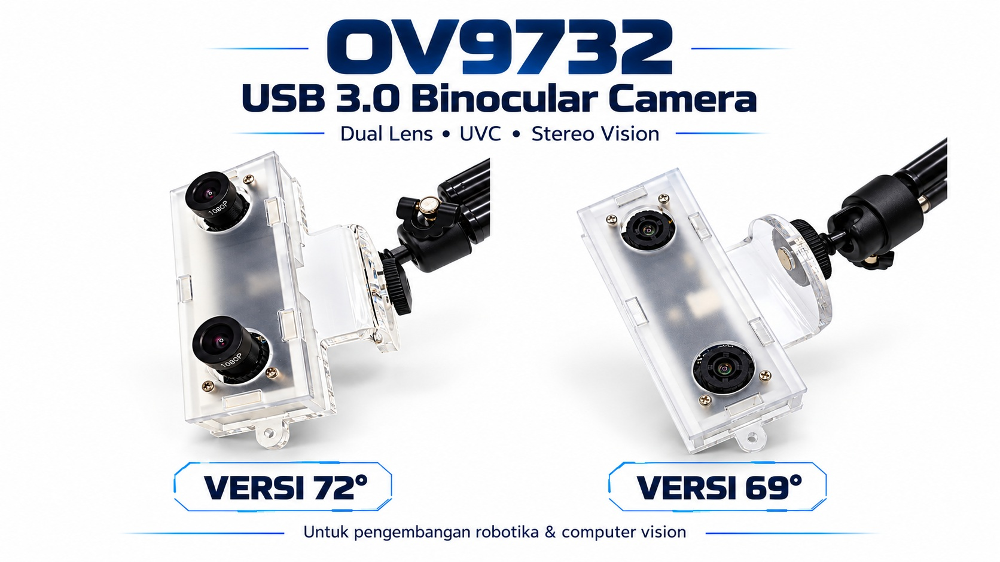

# USB Dual / Stereo Camera Viewer



Viewer untuk kamera stereo side-by-side **HBVCAM-W2280U3-2 V22 / Gearway OV9732** (USB ID `15aa:1555`) dan kamera sejenis.  
Kamera mengirim satu frame lebar yang menggabungkan gambar kiri dan kanan secara berdampingan (**side-by-side**); program ini membelah frame tersebut menjadi dua tampilan terpisah.

Tersedia tiga program:

| File | Tampilan | Keterangan |
|---|---|---|
| `check_dual_camera.py` | Terminal / OpenCV window | Viewer utama, ringan, tanpa dependensi GUI tambahan |
| `check_dual_camera-gui.py` | Qt5 GUI profesional | Pemilihan kamera via dialog, toolbar, dark theme |
| `test_hbvcam_stereo.py` | OpenCV window (3 jendela) | Diagnostik: verifikasi resolusi, FPS, dan snapshot |

---

## Persyaratan Sistem

| | Windows | Linux |
|---|---|---|
| Python | 3.8 – 3.12 | 3.8 – 3.12 |
| Backend kamera | DirectShow (bawaan Windows) | V4L2 (bawaan kernel) |
| Hak akses kamera | — | User harus masuk grup `video` |

---

## Instalasi Dependensi

### `check_dual_camera.py` (CLI / OpenCV window)

```bash
pip install opencv-python numpy
```

### `check_dual_camera-gui.py` (Qt5 GUI)

```bash
pip install opencv-python numpy PyQt5
```

> **Conda:** Jika menggunakan Anaconda / Miniconda, aktifkan environment terlebih dahulu:
> ```bash
> conda activate <nama-environment>
> pip install opencv-python numpy PyQt5
> ```

### Linux — izin akses kamera

```bash
sudo usermod -aG video $USER
# logout dan login kembali agar grup aktif
```

---

## Cara Menjalankan

### 1. `check_dual_camera.py` — CLI

```bash
# Auto-detect kamera (menu pilihan di terminal)
python check_dual_camera.py

# Paksa pakai device index tertentu
python check_dual_camera.py --device 2

# Paksa resolusi per-mata
python check_dual_camera.py --res 1280 720

# Linux: paksa device dan resolusi sekaligus
python check_dual_camera.py --device 4 --res 1280 720
```

**Kontrol keyboard saat viewer aktif:**

| Tombol | Fungsi |
|---|---|
| `Q` | Keluar |
| `S` | Simpan screenshot (`stereo_001.jpg`, dst.) |
| `F` | Toggle fullscreen |
| `H` | Toggle flip horizontal |
| `I` | Toggle info overlay (resolusi & FPS) |

---

### 2. `check_dual_camera-gui.py` — Qt5 GUI

```bash
python check_dual_camera-gui.py
```

Saat pertama dijalankan, **dialog pemilihan kamera** muncul otomatis:

- Pilih kamera dari daftar (kamera stereo yang direkomendasikan ditandai `★`)
- Pilih mode resolusi dari dropdown
- Klik **Hubungkan**

**Shortcut keyboard:**

| Tombol | Fungsi |
|---|---|
| `Ctrl+O` | Buka dialog ganti kamera |
| `Ctrl+S` | Screenshot dengan file dialog (JPG / PNG) |
| `H` | Toggle flip horizontal |
| `I` | Toggle info overlay |
| `F` | Toggle fullscreen |
| `Ctrl+Q` | Keluar |

**Mode resolusi yang tersedia:**

| Pilihan | Total frame | Per mata |
|---|---|---|
| Auto detect | Tertinggi yang didukung kamera | — |
| 2560 × 720 | 2560 × 720 | 1280 × 720 |
| 1280 × 480 | 1280 × 480 | 640 × 480 |
| 1600 × 600 | 1600 × 600 | 800 × 600 |

---

### 3. `test_hbvcam_stereo.py` — Diagnostik & Verifikasi

Script khusus untuk memverifikasi apakah kamera HBVCAM-W2280U3-2 berjalan di mode **USB 3.0** (frame rate tinggi) atau jatuh ke **USB 2.0 fallback** (frame rate rendah). Menampilkan tiga jendela sekaligus: frame gabungan, kamera kiri, dan kamera kanan.

**Dependensi:**

```bash
pip install opencv-python
```

**Penggunaan:**

```bash
# Dasar — index 0, 2560x720, MJPG
python test_hbvcam_stereo.py

# Tentukan index kamera secara eksplisit
python test_hbvcam_stereo.py --index 1

# Sesuaikan resolusi dan format pixel
python test_hbvcam_stereo.py --index 1 --width 2560 --height 720 --fourcc MJPG
python test_hbvcam_stereo.py --index 0 --width 1280 --height 480 --fourcc YUY2

# Tentukan folder penyimpanan snapshot
python test_hbvcam_stereo.py --index 1 --outdir ./hasil_capture
```

**Semua argumen:**

| Argumen | Default | Keterangan |
|---|---|---|
| `--index` | `0` | Index kamera (coba 0, 1, 2, … jika tidak terdeteksi) |
| `--width` | `2560` | Lebar total frame L+R |
| `--height` | `720` | Tinggi frame |
| `--fourcc` | `MJPG` | Format pixel: `MJPG` atau `YUY2` |
| `--outdir` | `./snapshots` | Folder penyimpanan snapshot |

**Kontrol keyboard:**

| Tombol | Fungsi |
|---|---|
| `S` | Simpan snapshot kiri dan kanan ke `--outdir` (format PNG) |
| `Q` / `ESC` | Keluar |

**Output di terminal:**

```
==================================================
Diminta   : 2560x720 @ MJPG
Aktual    : 2560x720 @ 0.0 fps (klaim driver)
==================================================
Tekan 's' untuk snapshot, 'q' atau ESC untuk keluar
```

> **Catatan:** Nilai FPS dari klaim driver sering `0.0` karena DirectShow / V4L2 tidak selalu melaporkannya dengan benar. FPS yang sebenarnya ditampilkan langsung pada frame video (`measured ~30.0 fps`).

**Cara membaca hasilnya — verifikasi USB 3.0 vs USB 2.0:**

| Resolusi diminta | Aktual | FPS terukur | Kesimpulan |
|---|---|---|---|
| 2560×720 MJPG | 2560×720 | ~30 fps | ✅ USB 3.0 normal |
| 2560×720 MJPG | 2560×720 | ~5–10 fps | ⚠️ Kemungkinan USB 2.0 fallback |
| 2560×720 MJPG | 640×480 | berapapun | ❌ Resolusi tidak ter-set, cek kabel/port |
| 1280×480 MJPG | 1280×480 | ~45 fps | ✅ USB 3.0 high-fps mode |

> **Penting dari vendor:** Gunakan **kabel USB asli** yang disertakan atau kabel USB 3.0 proper (berperisai/shielded). Kabel USB 2.0, kabel charging HP, atau kabel data murah akan menyebabkan koneksi jatuh ke mode USB 2.0 tanpa frame rate tinggi.

**Cek port USB di Linux:**

```bash
# Pastikan kamera terdeteksi di USB 3.0 (SuperSpeed)
lsusb -t
# Bus 002 = USB 3.0 (xhci), Bus 001 = USB 2.0 (ehci/ohci)

# Cek device video yang tersedia
v4l2-ctl --list-devices

# Cek format & resolusi yang didukung device
v4l2-ctl --device=/dev/video0 --list-formats-ext
```

---

### 4. `dist/DualCameraViewer.exe` — Standalone Windows

File executable siap pakai, **tidak memerlukan instalasi Python atau library apapun**.

```
dist\DualCameraViewer.exe
```

Cukup klik dua kali atau jalankan dari command prompt. Hanya tersedia untuk Windows 64-bit.

---

## Struktur Direktori

```
USB-dual-camera/
├── check_dual_camera.py        # Viewer CLI (OpenCV window)
├── check_dual_camera-gui.py    # Viewer Qt5 GUI profesional
├── test_hbvcam_stereo.py       # Diagnostik resolusi & FPS
├── camera_icon.ico             # Icon aplikasi
├── generate_icon.py            # Script pembuat icon (opsional)
├── assets/                     # Foto produk HBVCAM
├── Readme-Product.md           # Spesifikasi teknis kamera
├── dist/
│   └── DualCameraViewer.exe    # Executable Windows standalone
└── README.md
```

---

## Build Executable (Opsional)

Untuk membuat ulang `DualCameraViewer.exe` dari source:

```bash
pip install pyinstaller
pyinstaller --onefile --windowed --icon=camera_icon.ico \
    --name="DualCameraViewer" \
    --hidden-import=PyQt5.sip \
    --collect-all=cv2 \
    check_dual_camera-gui.py
# Hasil: dist/DualCameraViewer.exe
```

---

## Troubleshooting

### Kamera tidak terdeteksi (Windows)

- Pastikan driver kamera sudah terinstall (cek Device Manager)
- Coba paksa index manual: `--device 0`, `--device 1`, dst.
- Tutup aplikasi lain yang mungkin menggunakan kamera (Teams, OBS, dll.)

### Kamera tidak terdeteksi (Linux)

```bash
# Cek device yang tersedia
ls /dev/video*

# Cek nama device
cat /sys/class/video4linux/video0/name

# Test buka device
python check_dual_camera.py --device 0
```

### Gambar hanya satu sisi / tampak aneh

Kamera stereo OV9732 memerlukan resolusi **wide** (lebar × 2). Jika auto-detect gagal, coba resolusi manual:

```bash
python check_dual_camera.py --res 1280 720   # total frame: 2560x720
```

### Error `No module named 'cv2'`

```bash
pip install opencv-python
```

### Error `No module named 'PyQt5'`

```bash
pip install PyQt5
```

### Linux: `Unable to open video device`

```bash
sudo chmod 666 /dev/video0   # sementara
# atau permanen:
sudo usermod -aG video $USER
```

---

## Perangkat yang Diuji

| Perangkat | USB ID | Interface | Platform |
|---|---|---|---|
| HBVCAM-W2280U3-2 V22 (OV9732) | `15aa:1555` | USB 3.0 | Windows 11, Ubuntu 22.04 |
| Gearway OV9732 Stereo USB Camera | `15aa:1555` | USB 3.0 | Windows 11 |

Kamera lain dengan format side-by-side (kamera stereo generik UVC) kemungkinan besar kompatibel.  
Lihat [`Readme-Product.md`](./Readme-Product.md) untuk spesifikasi lengkap sensor dan tabel frame rate HBVCAM-W2280U3-2.
