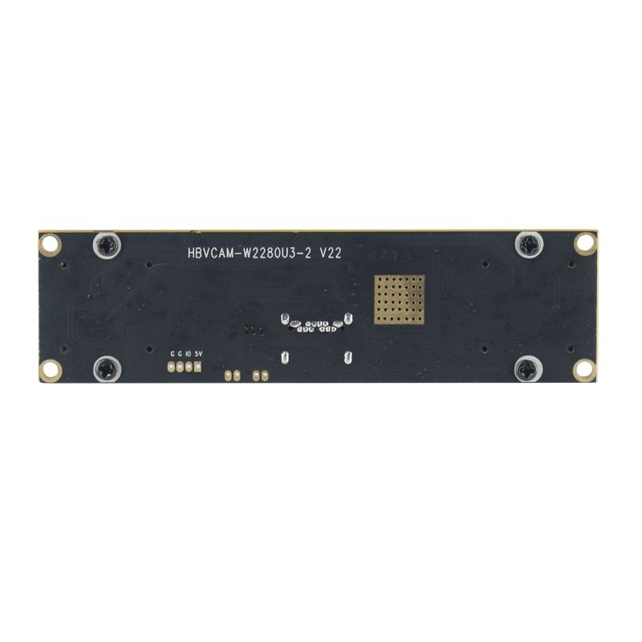
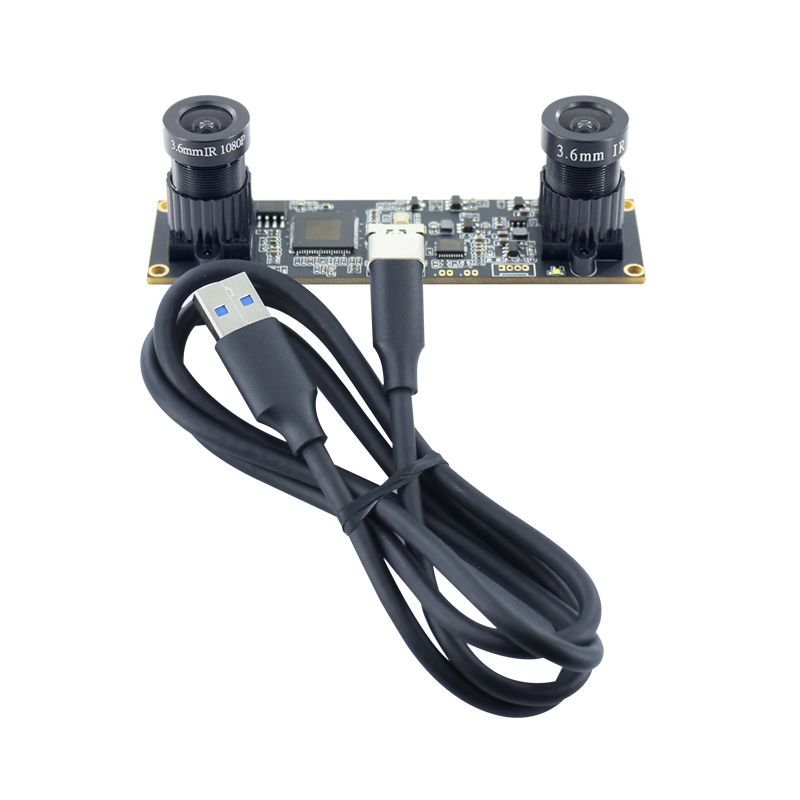
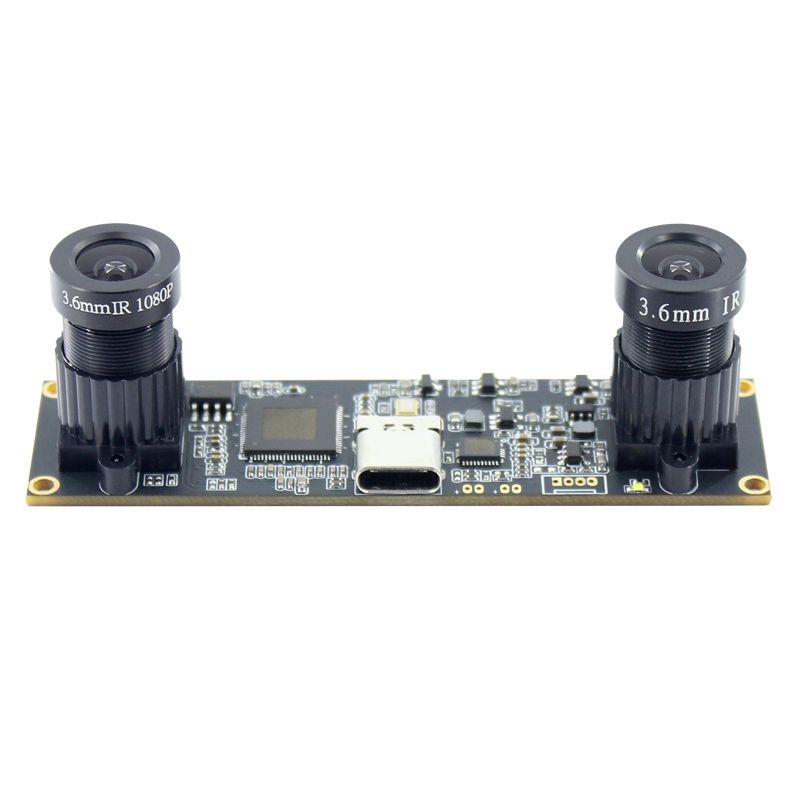
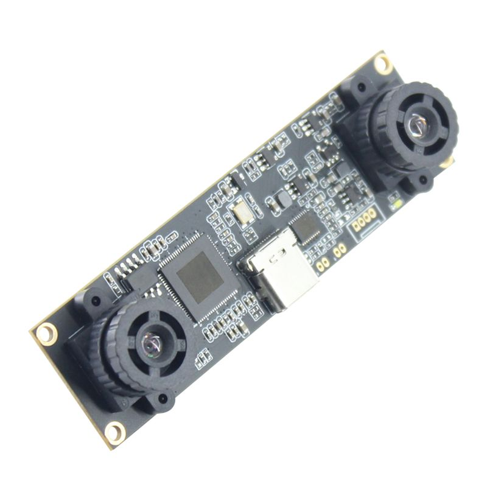

Spesifikasi lengkapnya:

### Ringkasan Produk

Modul kamera stereo/binocular USB3.0 dengan dua sensor 720p HD, dirancang untuk VR, naked-eye 3D, depth ranging, dan 3D reconstruction.

**Catatan dari vendor:**

- Versi upgrade "1780", sudah USB3.0 dengan YUY2 dan MJPEG di frame rate yang sama; konsistensi warna kamera kiri-kanan dioptimalkan; parameter kedua kamera bisa disetel bersamaan
- Frame rate tinggi: 1280×480 @45fps, 1280×360 @55fps
- **Penting:** wajib gunakan kabel USB asli (bukan kabel data USB2.0/charging HP sembarangan), karena jika tidak akan turun ke mode USB2.0-YUY2 tanpa frame rate tinggi

### Spesifikasi Mekanik & Lingkungan

| Parameter                | Nilai                        |
| ------------------------ | ---------------------------- |
| Module No.               | HBVCAM-W2280U3-2 V22         |
| Ukuran modul             | 80mm × 22mm × 16.20mm ±0.5mm |
| Suhu operasi             | -30°C s/d 70°C               |
| Suhu untuk gambar stabil | 0°C s/d 50°C                 |
| Teknik assembly          | SMT (RoHS)                   |
| Warna tinta PCB          | Hitam                        |

### Optik & Lensa

| Parameter                  | Nilai               |
| -------------------------- | ------------------- |
| Fokus                      | Fixed (tetap)       |
| Jarak objek                | 30cm – tak terbatas |
| Resolusi (center)          | 600 LW/PH           |
| Konstruksi lensa           | 2G2P                |
| F/No.                      | 2.4                 |
| EFL                        | 3.0mm               |
| FOV                        | 100°                |
| Distorsi TV                | <5%                 |
| Iluminasi relatif (sensor) | 70%                 |
| IR Filter                  | 650±10nm            |

### Sensor — OV9732

| Parameter             | Nilai            |
| --------------------- | ---------------- |
| Sensor                | OV9732 (1/4")    |
| Package sensor        | CSP, Bare Die    |
| Pixel size            | 3µm × 3µm        |
| Shutter type          | Global shutter   |
| Sensitivitas          | 2066mV/(lux-sec) |
| S/N Ratio             | 39 dB            |
| Max Dynamic Range     | 72 dB            |
| AGC/AEC/White balance | Auto             |
| Mikrofon              | Tidak ada        |

OV9732 adalah sensor CameraChip dari OmniVision, 720p HD, 35% lebih kecil dari generasi sebelumnya (OV9712), menggunakan teknologi pixel OmniPixel3-HS 3.0µm, CRA 9°, konsumsi daya hanya 99mW saat 720p@30fps mode low-power.

### Interface & Daya

| Parameter              | Nilai                                                        |
| ---------------------- | ------------------------------------------------------------ |
| Interface              | USB 3.0                                                      |
| Power supply           | USB bus power                                                |
| Tegangan suplai        | DC 5V ±5%                                                    |
| Konsumsi daya maksimum | 710 mW                                                       |
| OS yang didukung       | Win XP / Win 7,8 / Vista / Android 4.0 / Mac / Linux (dengan UVC) |
| Output format          | YUY2 / MJPEG                                                 |

### Resolusi & Frame Rate (Maksimum 2560×720)

| Resolusi       | MJPEG | YUY2  |
| -------------- | ----- | ----- |
| 320×240        | 30fps | 30fps |
| 320×232        | 30fps | 30fps |
| 640×480        | 45fps | 30fps |
| 640×472        | 45fps | 30fps |
| 640×352        | 60fps | 30fps |
| 640×360        | 60fps | 30fps |
| 640×240        | 30fps | 30fps |
| 800×592        | 30fps | 20fps |
| 800×600        | 30fps | 20fps |
| 1280×712       | 30fps | 5fps  |
| 1280×720       | 30fps | 5fps  |
| 1280×360       | 60fps | 10fps |
| 1280×480       | 30fps | 10fps |
| 1600×600       | 30fps | 10fps |
| 2560×720 (max) | 30fps | 5fps  |

*Mode Dual Resolution juga tersedia di resolusi 640×240, 1280×360, 1280×480, 1600×600, dan 2560×720 dengan frame rate yang sama seperti di atas.*